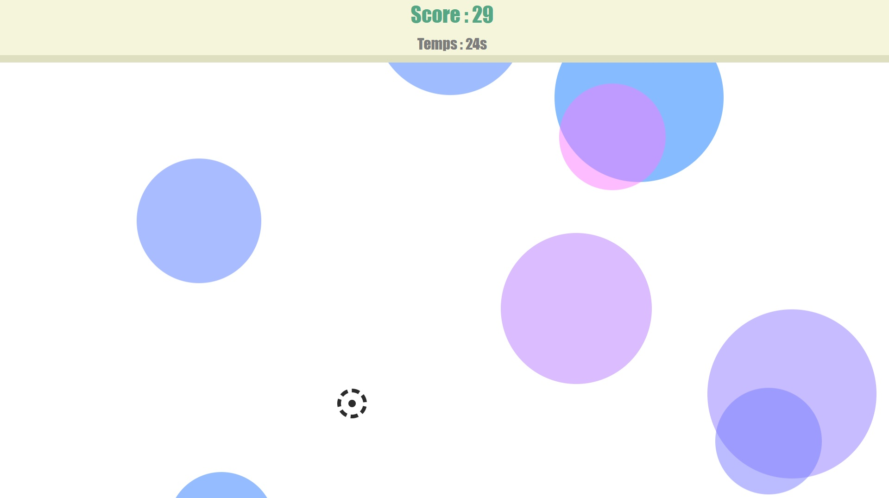

  

## Objectif du projet

Ce projet de mini-jeu interactif m'a permis de pratiquer la logique événementielle en JavaScript et de gérer le cycle de vie d'une partie.

### Réalisations techniques

- Manipuler des éléments de la page avec JavaScript.
- Réagir aux actions du joueur et mettre à jour le score.
- Utiliser des délais et des animations pour gérer l'apparition des bulles et le compte à rebours.
